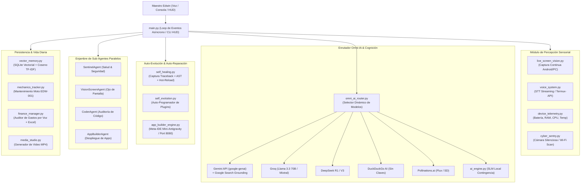

# ⚡ JARVIS OMNI-GHOST SUPREME (V2.5.0)

> **El Asistente Personal de IA Autónomo, Multi-Agente, Auto-Evolutivo y Multimodal más avanzado del mundo.**  
> Diseñado y optimizado para **Edwin** | Compatible con **Android (Termux / Termux API)** y **PC (Windows / Linux / macOS)**.

---

## 🏛️ 1. Arquitectura del Sistema



---

## 🚀 2. Capacidades y Módulos Principales

| Módulo | Archivo | Funcionalidad Clave |
|---|---|---|
| **Núcleo & HUD** | `main.py` | Loop `asyncio`, interfaz Cyberpunk Iron Man HUD, enrutador de comandos y eventos. |
| **Configuración** | `config.py` | Detección de plataforma Android/PC, perfil de Edwin, rutas locales y variables de entorno. |
| **Motor Gemini & SLM** | `modules/ai_engine.py` | Cliente `google-genai` con Google Search en vivo, visión multimodal y modo Offline SLM. |
| **Enrutador Multi-IA** | `modules/omni_ai_router.py` | Conexión a Groq, DeepSeek, DuckDuckGo AI, Hugging Face y Pollinations sin tarjeta de crédito. |
| **Visión de Pantalla** | `modules/live_screen_vision.py` | Captura continua en Android (`screencap`/ADB) y PC (`mss`/Pillow), comprensión de apps activas estilo Gemini Live. |
| **Controlador Android** | `modules/app_controller.py` | Automatización de toques (`input tap`), escritura (`input text`), teclas de hardware e intents de Android. |
| **Meta-IDE de Apps** | `modules/app_builder_engine.py` | Generador de aplicaciones completas HTML5/CSS3/JS, servidor HTTP local (`localhost:8080`) y auto-apertura. |
| **Auto-Reparación** | `modules/self_healing.py` | Intercepta excepciones, investiga soluciones, valida con `ast.parse` y recarga en caliente (`importlib.reload`). |
| **Auto-Evolución** | `modules/self_evolution.py` | Escucha solicitudes de nuevos poderes, crea plugins en `modules/plugins/` y los carga en vivo. |
| **Enjambre Multi-Agente**| `modules/agent_swarm.py` | Agentes concurrentes en paralelo: Centinela, Visión, Coder y App-Builder. |
| **Memoria Semántica** | `modules/vector_memory.py` | Base vectorial SQLite con similitud coseno para recordar datos y preferencias de Edwin. |
| **Estudio Multimedia** | `modules/media_studio.py` | Generación de imágenes (Flux) y ensamblador de video `.mp4` con locución y subtítulos. |
| **Voz Bidireccional** | `modules/voice_system.py` | TTS neuronal (`edge-tts` / `termux-tts-speak`) y escucha continua (STT). |
| **Telemetría & Centinela**| `modules/device_telemetry.py`<br/>`modules/cyber_sentry.py` | Batería, RAM, fotos silenciosas de seguridad, transferencia P2P y escáner Wi-Fi anti-intrusos. |
| **Mecánica & Finanzas** | `modules/mechanics_tracker.py`<br/>`modules/finance_manager.py` | Mantenimiento para la moto de Edwin (aceite, cadena) y auditor de gastos con exportación a Excel. |
| **Herramientas & Macros** | `modules/assistant_tools.py` | Modo Noche, Modo Turbo, Modo Guardia y redactor de comunicaciones. |

---

## 📲 3. Instalación y Uso en Android (Termux)

1. **Instala Termux y Termux:API** desde [F-Droid](https://f-droid.org/).
2. Clona o copia los archivos del proyecto en el almacenamiento de Termux:
   ```bash
   cd ~
   # Clonar o transferir repositorio
   ```
3. Ejecuta el instalador maestro automatizado:
   ```bash
   bash setup_termux.sh
   ```
4. Inicia Jarvis Supreme:
   ```bash
   python3 main.py
   ```

---

## 💻 4. Instalación y Uso en PC (Linux / Windows / macOS)

1. Clona el repositorio e ingresa al directorio:
   ```bash
   git clone <repo-url>
   cd jarvis-omni-ghost-supreme
   ```
2. Instala los requerimientos:
   ```bash
   pip install -r requirements.txt
   ```
3. Inicia el sistema:
   ```bash
   python3 main.py
   ```

---

## 🌐 5. Visualización del Panel Maestro y Apps Creadas

Jarvis cuenta con un servidor web local integrado que aloja tanto el panel HUD interactivo como las aplicaciones que el asistente desarrolle para ti:

- **Panel Maestro Interactivo:** [http://localhost:8080/jarvis_dashboard/](http://localhost:8080/jarvis_dashboard/)
- **Directorio de Apps Creadas:** `apps_created/`

---

## 💬 6. Comandos por Voz o Consola

- **Percepción de Pantalla:**  
  `"pantalla"` o `"¿qué app tengo abierta?"`
- **Crear Aplicaciones al Vuelo:**  
  `"crear app gestor de proyectos con tablero kanban y modo oscuro"`
- **Auto-Evolución (Crear Plugins en Caliente):**  
  `"aprende a monitorear el precio de Ethereum"`
- **Auditoría de Gastos por Voz:**  
  `"gasté 50 mil pesos en repuestos de moto"`  
  `"exportar excel"` *(genera automáticamente un libro .xlsx con formato corporativo y fórmulas)*
- **Mantenimiento Mecánico de la Moto:**  
  `"moto"` o `"kilometraje 15200"`
- **Macros del Sistema:**  
  `"modo noche"` *(atenúa brillo, activa centinela y reporta batería)*  
  `"modo turbo"` *(libera RAM y acelera hilos del enjambre)*  
  `"modo guardia"` *(toma foto silenciosa y escanea intrusos en el Wi-Fi)*
- **Ciberseguridad:**  
  `"foto"` | `"scan wifi"` | `"p2p"`

---

## 🛡️ 7. Seguridad y Privacidad

- **Zero Cloud Leak:** Toda la memoria semántica, fotos de seguridad y finanzas residen exclusivamente en bases de datos SQLite locales en tu dispositivo (`storage/jarvis_memory.db`).
- **Transferencia P2P:** Sincronización directa entre móvil y ordenador a través de la red local sin pasar por servidores de terceros.
- **Validación AST:** Ningún código auto-generado se ejecuta sin previa validación sintáctica estricta.

---
*Desarrollado con orgullo para **Edwin** por **Jarvis Omni-Ghost Supreme**.*
